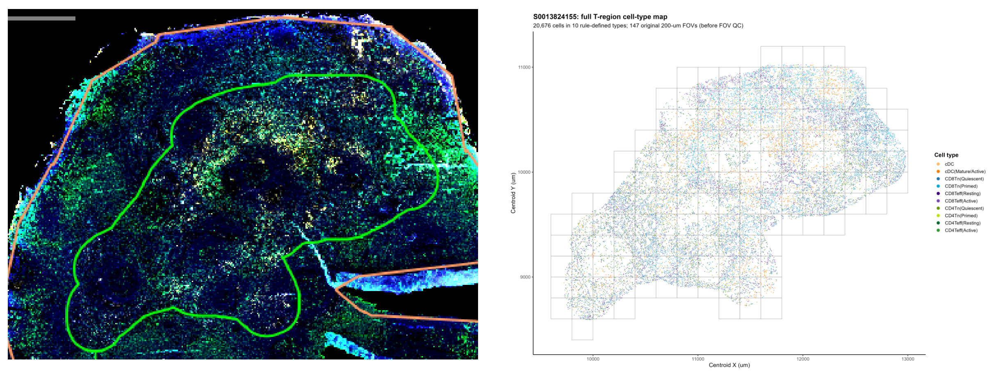
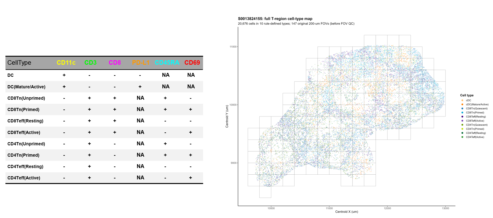
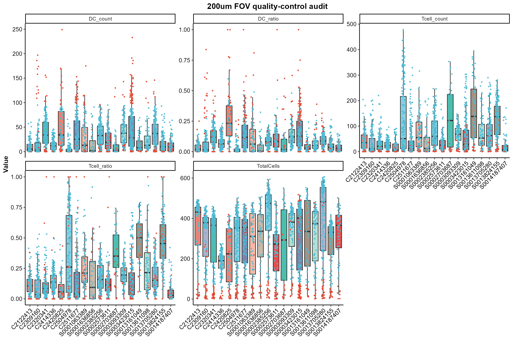

# cellfiers

**从 QuPath 圈选的组织区域出发，在 R 中完成多重免疫荧光（mIF）的细胞注释、空间邻域分析与可视化。**

[安装](docs/installation.md) · [快速入门](docs/quickstart.md) · [函数参考](docs/reference.md) · [版本更新](NEWS.md)

## cellfiers 能做什么

### 1. 衔接 QuPath 的灵活选区与 R 分析

在 QuPath 中按组织形态圈选感兴趣的区域，检测细胞，再导出细胞坐标、荧光强度和所属选区。进入 R 后，可以只保留指定区域，并用同一套流程分析不同样本。

```text
QuPath 圈选组织区域 → 检测细胞 → 导出单细胞测量表
    ↓
筛选选区 → 应用逐样本阈值 → 按规则注释细胞
    ↓
FOV 网格化与质控 → 中心细胞邻域分析 → 原位图、热饼图和结果表
```

### 2. 用统一网格比较空间分布

即使 QuPath 圈选的组织区域形状不规则，也可以用相同大小的 FOV 汇总不同区域的细胞组成和邻域特征。网格默认是 **200 µm × 200 µm**，边长可自定义。



### 3. 按样本注释细胞并检查 FOV 质量

样本间的荧光背景可能不同。cellfiers 支持逐样本设置标记物阈值，并按自定义规则判定细胞类型。细胞组成图和原位图可以用于复核注释。



FOV 质控可标记细胞数过少、DC 占比异常高或指标位于指定分位数范围之外的区域。阈值可按项目调整，质控表记录各 FOV 的筛选结果。



### 4. 用热饼图展示中心细胞的邻域

指定中心细胞、目标细胞和搜索半径后，可把邻域结果映射回组织。热饼图用方格底色、饼图扇区和饼图面积分别呈现三种信息。


| 图中元素 | 代表什么 |
| --- | --- |
| 方格的粉色深浅 | 先计算每个中心细胞邻近的目标细胞类型数，再对 FOV 内的中心细胞取平均。颜色越深，平均邻近的目标类型越多。 |
| 饼图扇区 | 指定目标细胞的加权组成。若同一个目标细胞被 `m` 个中心细胞共享，默认对每个中心贡献 `1/m`。 |
| 饼图面积 | FOV 内每个中心细胞的平均加权目标细胞丰度。 |

## 淋巴结 mIF 示例

下面是一例 7-plex mIF 淋巴结的 T 区分析。按规则注释后，以 200 µm 网格进行 FOV 质控。图中显示通过质控的细胞，每个点代表一个细胞，颜色对应规则定义的细胞类型。


以 `cDC` 和 `cDC(Mature/Active)` 为中心，统计 **20 µm 半径**内四类目标 T 细胞，并将结果汇总到中心细胞所属的 FOV。浅黄、绿、灰和白分别表示无目标但有中心细胞作为邻居、指定的其他细胞邻域、其他或孤立邻域，以及无中心细胞的 FOV。


## 常用函数

| 功能 | 推荐入口 |
| --- | --- |
| 读取、选区与注释 | `read_qupath()`、`read_qupath_batch()`、`run_annotation()` |
| 网格化和 FOV 质控 | `assign_fov()`、`run_fov_qc()` |
| 邻居组成和组间比较 | `analyze_neighbors()`、`compare_neighbors()`、`plot_neighbors()` |
| 指定中心与目标的邻域分析 | `target_neighbors()`、`plot_heatpie()` |

## 安装

需要 **R ≥ 4.1**。在 R 中运行以下命令安装：

```r
install.packages("remotes")
remotes::install_github("Porpax/cellfiers", dependencies = NA, upgrade = "never")
library(cellfiers)
```

[安装说明](docs/installation.md)列出运行时依赖和本地安装方法。[快速入门](docs/quickstart.md)使用随包提供的模拟数据，完整演示从注释到热饼图的流程。

## 函数帮助

```r
help("target_neighbors", package = "cellfiers")
help("plot_heatpie", package = "cellfiers")
```

[函数参考](docs/reference.md)按任务列出参数、默认值、返回值和示例。旧脚本仍可使用原函数名，名称对照见参考页。

cellfiers 采用 [Creative Commons Attribution 4.0 International（CC BY 4.0）](LICENSE) 许可。引用或再分发时，请注明 cellfiers 及作者 Zihan Chen。
