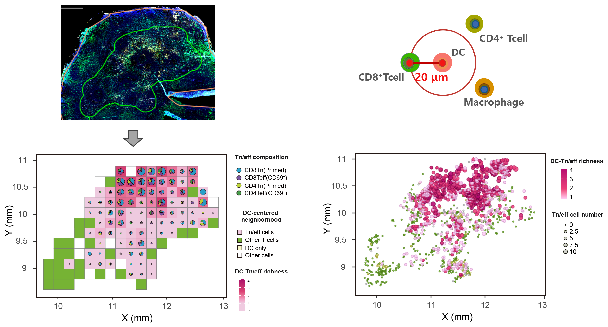
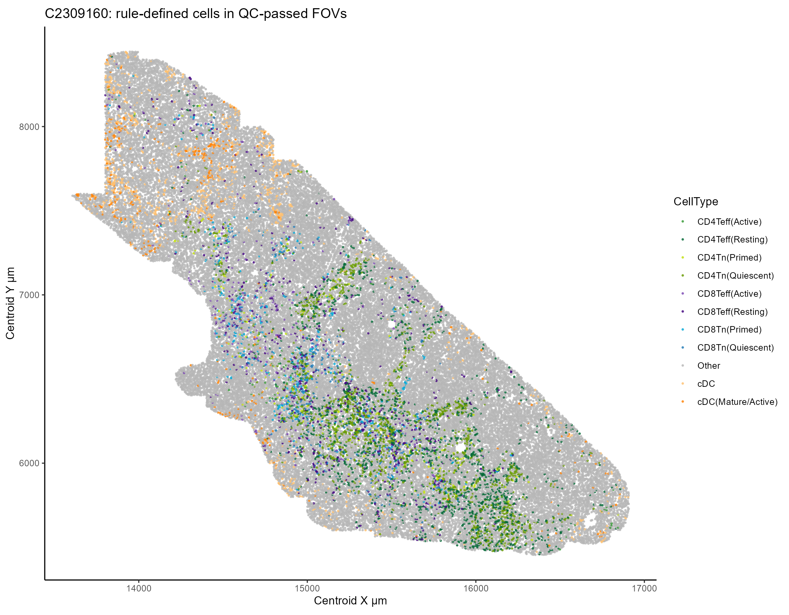
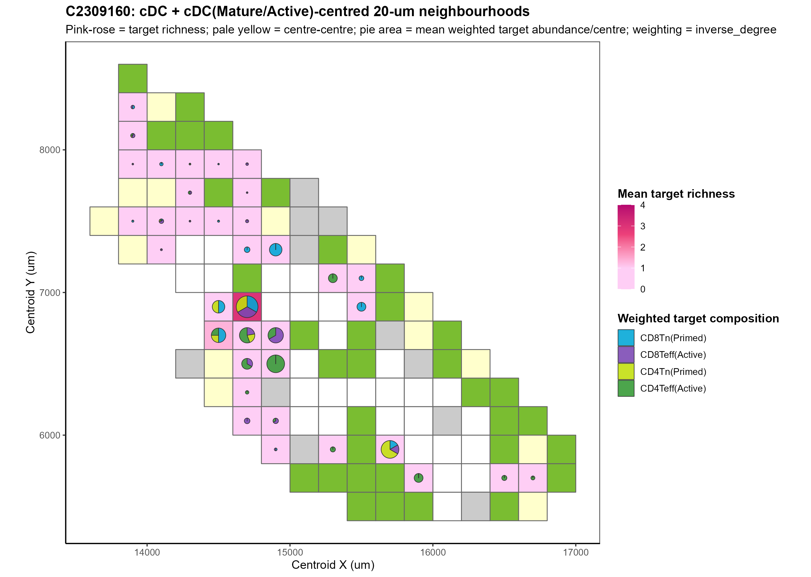

# cellfiers

**Cell phenotyping, spatial neighbourhood analysis, and visualisation in R for multiplex immunofluorescence (mIF) data exported from QuPath.**

[Installation](docs/installation.md) · [Quick start](docs/quickstart.md) · [Function reference](docs/reference.md) · [Release notes](NEWS.md)

## Features

### 1. Analyse user-defined tissue regions from QuPath

Annotate regions of interest in QuPath, detect cells, and export cell coordinates, fluorescence intensities, and region labels. In R, select the regions relevant to your study and apply a consistent workflow across samples.

```text
Annotate tissue regions in QuPath → Detect cells → Export single-cell measurements
    ↓
Select regions → Apply sample-specific thresholds → Assign cell phenotypes using rules
    ↓
Tile tissue into FOVs and apply QC → Analyse cellular neighbourhoods → Generate spatial maps and summary tables
```

### 2. Summarise spatial patterns on a common grid

Partition irregularly shaped tissue regions into square fields of view (FOVs) and summarise cell composition and neighbourhood features at a common spatial scale. The default grid is **200 µm × 200 µm**, with a configurable side length.


### 3. Phenotype cells and assess FOV quality

Account for differences in fluorescence background by setting marker thresholds for each sample and assigning phenotypes with user-defined rules. Review the resulting cell-type composition and spatial distribution.


FOV-level quality control (QC) can flag low cell counts, high dendritic cell (DC) fractions, and values outside a specified quantile range. The QC table records the outcome for each FOV.


### 4. Visualise centre-cell neighbourhoods with heat-pie maps

Select centre cell types, target cell types, and a search radius. The heat-pie map summarises radius-defined neighbourhoods on the tissue grid. These summaries can help characterise candidate spatial niches.



| Visual element | Interpretation |
| --- | --- |
| Pink tile shading | Mean target cell-type richness across centre cells in the FOV. Richness is the number of distinct target cell types within the search radius of a centre cell. |
| Pie sectors | Weighted target cell-type composition. By default, a target cell shared by `m` centre cells contributes `1/m` to each. |
| Pie area | Mean weighted target-cell abundance per centre cell in the FOV. |

## Lymph node mIF example

This example uses seven-plex mIF data from a lymph node T-cell region. Cells were phenotyped using a rule table, and QC was applied to 200 µm FOVs. Each point shows a cell in a FOV that passed QC, coloured by its assigned phenotype.



The analysis uses `cDC` and `cDC(Mature/Active)` as centre cell types and quantifies four target T-cell phenotypes within a **20 µm radius**. Results are aggregated by the FOV containing each centre cell. Pale yellow indicates centre–centre neighbourhoods without targets, green indicates neighbourhoods with specified non-target cells, grey indicates other or isolated neighbourhoods, and white indicates FOVs without centre cells.



## Common functions

| Task | Functions |
| --- | --- |
| Import, region selection, and phenotyping | `read_qupath()`, `read_qupath_batch()`, `run_annotation()` |
| Grid assignment and FOV quality control | `assign_fov()`, `run_fov_qc()` |
| Neighbourhood composition and group comparisons | `analyze_neighbors()`, `compare_neighbors()`, `plot_neighbors()` |
| Target-cell neighbourhood analysis and visualisation | `target_neighbors()`, `plot_heatpie()` |

## Installation

Install cellfiers from GitHub in **R ≥ 4.1**.

```r
install.packages("remotes")
remotes::install_github("Porpax/cellfiers", dependencies = NA, upgrade = "never")
library(cellfiers)
```

The [installation guide](docs/installation.md) lists the dependencies and explains how to install from local source. The [quick start](docs/quickstart.md) uses bundled simulated data to demonstrate the workflow from cell phenotyping to heat-pie visualisation.

## Function documentation

```r
help("target_neighbors", package = "cellfiers")
help("plot_heatpie", package = "cellfiers")
```

The [function reference](docs/reference.md) lists usage, arguments, defaults, return values, and examples. It also documents the aliases retained for compatibility with earlier scripts.

cellfiers is licensed under [Creative Commons Attribution 4.0 International (CC BY 4.0)](LICENSE). When citing or redistributing the package, credit cellfiers and its author, Zihan Chen.
